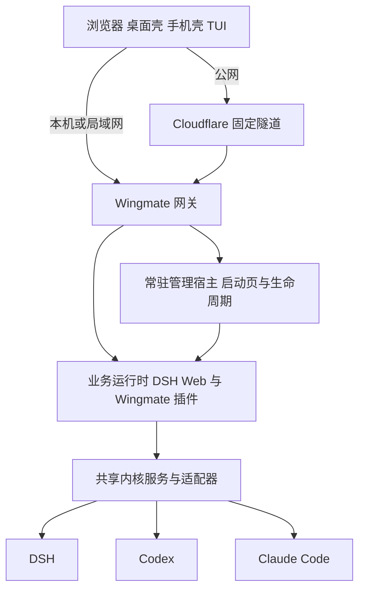
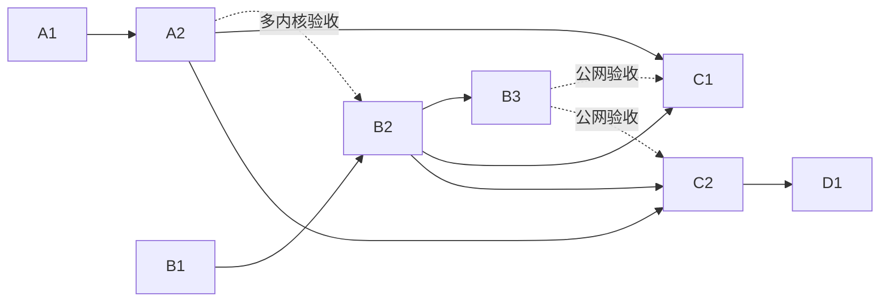

# Wingmate 多内核与多端接入实施方案

制定日期：2026-11-11。状态：B1 实施中，其余任务未开始。

本文是本轮工作的临时实施入口，供后续子任务直接查阅。目标是共享 DSH、Codex、Claude Code 等执行后端，以完整 Web 分享支持本机、局域网和公网访问，再接入 TUI 与 Android。当前实施 B1，不将后续网关、多内核及隧道能力计为已交付。

先读 [项目约定](docs/product.md)，再读本文及任务涉及的模块 README。本文中的目标能力不代表已交付；当前能力仍以模块文档和代码为准。任务完成后按[文档收尾](#文档收尾)迁移需要长期保留的约定，再移除本文。

## 已确定的业务选择

| 事项 | 选择与理由 |
| --- | --- |
| 产品形态 | 延续 Wingmate 的运行时发行、后台管理和 DSH 插件路线。浏览器、桌面、手机共用主机提供的 DSH Web，TUI 使用独立终端界面。 |
| 远程访问 | 分享完整 Web，包括页面、插件资源和业务连接；局域网直连，公网经 HTTPS 隧道到同一个 Wingmate 网关。不维护远程专用聊天页面或另一份官方 Web。 |
| 公网入口 | 使用主机地址和一次配对认证，客户端保存连接记录。不建立 Wingmate 统一账号平台、中央主机目录或自部署中继服务器。 |
| 隧道 | 首个实现选 Cloudflare 固定隧道，网关保持通用，隧道是可替换组件。实际连通性、流式响应和文件传输验证留到 B3，不作为前期设计或内核开发的前置条件。 |
| 使用者与权限 | 本人多设备使用。连接认证成功后拥有该主机的完整操作权限，不做多用户、只读分享、项目级权限或角色划分。保留连接认证和授权撤销，避免将完整权限变成匿名开放。 |
| 内核切换 | 当前工作台整体切到目标后端：工作区、目录、会话列表、历史、实时内容和新建操作都由目标后端提供。已有会话不跨内核迁移。 |
| 远程启停 | 最终要求业务后台停止后，远程仍可打开 Wingmate 启动页并再次启动。管理入口必须独立于业务后台存活。 |
| 开发期进程 | 在独立服务宿主任务交付前，保留桌面与 CLI 管理、关闭桌面后留下运行 DSH 的 Node 及其子进程的现状。模块拆分不立即改变进程结构。 |
| 后续服务交付 | 不依赖 GUI 的 Wingmate 入口并列携带独立管理服务、运行资源及可选界面组件；入口负责版本协调、资源释放和服务引导，管理服务只使用已安装内容。开发模式也运行释放副本。 |
| 移动端 | Android 使用 WebView 和必要的原生能力，不移植整套 Flutter 聊天界面。提供远程版、包含本地运行时版两种编译组合。 |
| TUI | 移植 dsh-TUI 的终端界面，通过 `wingmate tui` 启动。保留内核选择交互，执行驱动和内核管理由共享后台提供。 |
| 排期 | 先完成共享内核和远程基础，再做 TUI、移动远程版，最后增加移动本地运行版。技术依赖与建议排期见任务表。 |

Cloudflare 固定隧道需要将域名接入 Cloudflare DNS，域名可以在其他注册商购买。采用基础免费隧道、以域名注册和续费为主要外部费用的方案，不要求购买公网服务器。域名采购和账号配置留到接入任务；具体使用条件以届时的[隧道文档](https://developers.cloudflare.com/tunnel/get-started/)及[域名接入说明](https://developers.cloudflare.com/dns/zone-setups/full-setup/setup/)为准。

ds-harness-remote 的托管站点服务于其专用业务协议，当前没有把它作为通用完整 Web 隧道的现成接入路径。本方案不依赖该站点，保留其后端展示适配、连接恢复和交互设计作为参考。Tailscale 与 Cloudflare 临时隧道不属于首轮实现范围。

## 运行架构与演进边界

### 当前结构

`wingmate-service` 是桌面和 CLI 共用的 Rust 库，尚不是独立常驻服务。当前控制入口 [runtime/control.mjs](runtime/control.mjs) 与 DSH 运行在同一个 Node 进程；桌面退出后后台可以继续工作，但这个 Node 退出后不能自行接收远程启动请求。当前所有权规则见[服务模块](crates/wingmate-service/README.md)。

A1、A2 在此结构上完成共享内核与 Web 切换。B1 才引入独立服务宿主，B2 交付完整的局域网入口和远程停止后再启动。不能把前两阶段的本机能力标记成已支持远程恢复。

### 目标结构

图中的网关和管理宿主可以在同一个轻量进程中；拆分职责不要求拆成多个守护进程。浏览器经网关访问完整站点，TUI 经同一主机的业务接口访问后台。公网只是将入口延伸到 HTTPS 地址，不再增加一套会话传输协议。

这里区分三种角色：

- **管理宿主**：Wingmate 自己拥有，负责发现、认证、启动页、进程与运行包管理、网关及隧道生命周期，不依赖 DSH 插件成功加载。
- **业务运行时**：提供 DSH Web、插件宿主和共享内核服务；初期仍基于所选 DSH 发布包组合，不另建一套 Agent 平台。
- **执行后端**：DSH、Codex、Claude 等负责实际任务和各自原生会话。切到 Codex 后，DSH Web 与插件宿主仍可运行，执行任务交给 Codex。

共享内核模块在主机端运行，先由 DSH 插件装配；源码独立不意味着现在要再启动一个专门的 JavaScript 服务。DSH 的原生 Agent、工具、权限和插件能力继续走官方服务，公共接口不强行压缩所有后端为最低共同能力。

### 生命周期语义

| 用户操作 | 目标行为 |
| --- | --- |
| 关闭桌面或手机界面、退出 TUI | 释放客户端连接，后台与任务继续；单纯退出 TUI 不停止它创建的任务。 |
| 网络断开、刷新或重连 | 不重启后台、不自动重放发送或审批。重新读取实际状态，恢复订阅。 |
| 切换工作台内核 | 仅改变该客户端的显示与后续操作目标；其他后端任务与其他客户端的选择继续有效。 |
| 停止或重启业务后台 | 明确说明受影响任务并执行操作；管理宿主和远程入口继续可用。业务后台停止后显示启动与恢复入口。 |
| 退出管理宿主或关闭远程访问 | 远程入口不可用；相关业务进程的处理必须有明确操作语义，不以窗口关闭代替。 |

“后台停止后远程启动”的前提是电脑仍开机、网络与管理宿主可用；不包含关机或休眠唤醒。短暂断线不能立即销毁工作台草稿或强制导航，延续现有[桌面行为](src-tauri/README.md#用户操作与权限边界)。

### 服务释放与升级

B1 在 `wingmate-service` 内提供独立服务可执行程序，不另建 `wingmate-host`。无 GUI 的 `wingmate` 发行入口负责资源释放、版本协调、服务引导和命令注册；服务、运行资源与可选桌面组件并列内嵌，资源不嵌进服务。服务构建不依赖发行入口或桌面构建，服务器可通过 CLI 完成准备和启动。

开发服务运行在当前工作副本 `work/dev` 下的受管目录；发行服务运行在 Wingmate 管理目录下。两者都运行已释放的副本，不从 `target` 直接启动长期运行的服务，也不让发行入口 充当常驻宿主。

服务组件按内容指纹使用独立目录；新构建不覆盖运行中的旧文件。入口启动时先确认并连接已有服务，不因为服务或运行包版本不同而擅自重启任务。明确重启后才切换组件，并在确认不再使用后回收旧目录。B1 应把具体规则纳入[运行时维护指南](docs/runtime-maintenance.md)，复用其组件所有权和释放机制。

宿主管理协议的兼容性与 DSH 运行包兼容性分别判断；无法连接旧宿主时提供可执行的显式停止或迁移路径。不保留旧后台发现协议迁移，具体管理协议在 B1 确定，不把当前 DSH 版本直接当作未来宿主协议版本。

## 内核切换与数据归属

### 工作台切换

操作顺序是选择主机、选择后端，再选择该后端的工作区与会话。切换内核时，项目或工作区导航、工作目录、会话列表、历史、实时事件、模型与权限控件都切到目标后端。它不是模型下拉框，也不只是新建会话时的一个参数。

同一个文件目录可以分别存在 DSH、Codex 和 Claude 会话，但会话标识和状态绑定所属主机、后端及原生会话，不能只按裸会话 ID 混用。每个客户端可记住各后端上次的导航位置，后端选择不成为所有窗口共用的全局开关。

在目标工作台中新建项目、新建或恢复会话、发送消息、中断和回答审批，都由目标后端适配器处理。目标不可用时显示该后端的问题，不回落为 DSH 操作。原生没有“项目”实体的后端，由其适配器提供必要的目录索引与映射；不把映射写成 DSH 项目或会话。共享目录不等于跨内核共享对话上下文。

### 共享能力与界面适配

共享模块负责后端探测、实际能力、工作区与会话访问、历史与增量事件、输入、中断及审批。具体类型和接口在 A1 随可运行的闭环确定，不提前设计通用插件市场或庞大 SDK。

Web 适配将目标后端信息投影到官方工作台；TUI 适配投影到终端界面。底层驱动只在后台保留一份，客户端不直接启动 Codex 或 Claude。原生不支持的能力按真实状态隐藏或说明，不伪造成功。首次接入即用 dsh-TUI 的会话接口检查公共边界，正式 TUI 移植仍在 C1。

各后端自己的原生会话及凭据存储保持权威。Wingmate 只保存必要的索引、偏好和关联信息，Web/TUI 的展示投影不是第二份转录数据库。DSH 数据规则沿用[项目约定](docs/product.md#数据归属)。外部后端运行时由系统安装还是按需部署，在对应接入任务确定；“内置后端适配”不等于必须捆绑全部第三方 CLI 和 SDK。

## 网关与客户端边界

网关提供一个主机入口：认证后访问启动页或完整业务站点。HTML、静态资源、插件资源、文件访问、业务 API 和长连接按实际运行时一起接入；只让首页或聊天文本可达不算完成完整 Web 分享。网关转发到受管业务运行时，不承担内核切换和会话数据转换。

局域网扫码或复制链接完成配对，公网经固定 HTTPS 地址进入同一个主机。云平台账号只用于配置隧道，不成为 Wingmate 的业务账号。认证由独立管理层拥有；业务后台停机不能让认证与启动页一起消失。隧道转发的请求也不能仅因本机回环来源就获得本机管理权限。

DSH 中的 Wingmate 设置面板负责方便地显示和调用管理能力，实际操作归当前连接主机。远程网页不能借桌面壳的桥接去管理客户端所在电脑。打开本机目录、窗口控件等原生能力继续由各壳按来源和用户操作提供。

桌面、手机与普通浏览器共用业务 Web，不承诺原生能力完全一致。手机壳负责扫码、连接记录、系统文件选择及必要的键盘、通知和生命周期适配。浏览器不获得任意 Tauri 或 Android 原生权限。

Android 两种构建组合共用界面与连接逻辑：远程版不包含本地执行环境；本地运行版增加原生安装、进程管理、前台服务与运行载荷，启动本机业务运行时后仍打开同一套 Web。本机后端可用性按 Android 实测能力报告，不由桌面支持情况推断。桌面 Rust 服务宿主不直接视为 Android 可执行产物。

## 模块划分与代码位置

以下是实施目标路径；标记“新增”的目录在所属任务开始时创建。本轮不创建空模块。需要调整路径时同步本表及相关模块 README，保持职责不变。

| 位置 | 状态与职责 | 引入任务 |
| --- | --- | --- |
| `crates/wingmate-service/` | 现有。独立常驻服务，保留后台身份、进程所有权与已安装运行内容的启停规则，不负责发行资源释放；不放 Web/TUI 的聊天展示或厂商协议。 | B1 演进 |
| `crates/wingmate-launcher/` | 新增无 GUI 的发行入口，负责组件载荷、版本协调、释放、服务引导和命令注册。`wingmate-service` 自身提供服务可执行入口，后续网关与隧道仍归服务模块。 | B1、B2、B3 |
| `packages/agent-backends/` | 新增共享内核模块。包含中立契约、后端注册与 DSH/Codex/Claude 适配；DSH 专属依赖留在适配边界。由业务插件装配，不依赖某个 UI 或远程隧道。 | A1、A2 |
| `plugins/wingmate-backends/` | 新增 DSH 组合插件。宿主部分装配共享内核并提供业务接口，客户端部分提供整个 Web 工作台切换与投影；复用官方扩展点，不复制完整官方前端。 | A1、A2 |
| `plugins/wingmate-web/` | 现有管理面板。逐步扩展为当前主机的服务与远程访问设置入口，操作交给 Wingmate 管理宿主；不在此保存唯一的远程控制实现。无需另建拥有后台生命周期的 `wingmate-remote` 插件。 | B2、B3 |
| `apps/launcher/` | 从现有首页提取的共享启动、连接与恢复页面，由桌面和网关共同使用。它不承载聊天。 | B2 |
| `apps/desktop/`、`src-tauri/` | 现有桌面入口、原生桥接与窗口行为；复用共享启动页，支持选择本机或已保存的远程主机。 | B1、B2 |
| `packages/wingmate-client/` | 按实际复用提取连接、业务调用与事件订阅客户端。管理协议和后端业务接口保持区分；不含执行驱动。第二个真实消费者出现时再抽包。 | B2、C1 按需 |
| `apps/tui/` | 移植终端界面及其展示适配，作为 `wingmate tui` 的运行内容。只连接共享后台，不再装配另一套内核或运行时管理。 | C1 |
| `apps/mobile/` | Android 壳、扫码和连接管理；本地运行版的 Android 原生服务适配也归这里。具体壳技术在 C2 确定。 | C2、D1 |
| `runtime/`、`scripts/` | 运行内容声明、锁定来源、补丁、组件组装和发行验证；Android 载荷声明按需放 `runtime/android/`。生成物继续放 `work`，不把本机参考目录当构建输入。 | 随对应任务 |

依赖方向是客户端到管理或业务接口、业务插件到共享后端、后端适配到原生运行时；隧道只连接网关。管理宿主不反向依赖 DSH 管理面板，TUI 与手机壳不反向成为共享模块的依赖。

源码放在 `packages` 不代表其依赖已经随发行包部署。新增插件须满足[预装运行产物自足约定](docs/runtime-maintenance.md#打包范围与所有权)：可内联的共享代码进入插件构建产物；必须外置的 SDK、CLI 或原生依赖要先实现明确部署和检查，不能靠开发 workspace 链接或碰巧存在的依赖运行。

## 参考项目与复用范围

下表是 2026-11-10 阅读的本地源码快照，不是 Wingmate 发行依赖版本表。实际采用代码时另按[来源与集成规则](docs/runtime-maintenance.md#社区和自用插件集成)记录来源、适配和许可证，精确依赖进入配置与锁文件。

| 项目与参考提交 | 本机副本 | 优先查阅与复用范围 |
| --- | --- | --- |
| [deepseek-harness-desktop](https://github.com/dsh-tauri/deepseek-harness-desktop/tree/fa55bd68883e) | `D:/opensource/deepseek-harness-desktop` | `packages/builtin-plugin-remote/src/host/service/` 的网关和隧道，`apps/native/` 的 WebView 配对与原生交互。原项目宿主服务机制需替换为 Wingmate 边界；不引入其整套 Electron 桌面。 |
| [ds-harness-remote](https://github.com/liguobao/ds-harness-remote/tree/7d4d73baee7b) | `D:/opensource/ds-harness-remote` | `packages/plugin/src/codex/`、`acp/` 的工作台投影与能力处理，以及 `typert-gateway-switch.ts`。不把账号服务、专用加密业务通道和远程工作台整体并入。 |
| [dsh-TUI](https://github.com/ccch1mneyyy/dsh-TUI/tree/de73c6f3e5fa) | `D:/opensource/dsh-TUI` | `docs/agent-backend-design.md`、`src/agent/`、`src/backends/` 的后端契约与驱动，及终端界面。原版会在自身进程装配后端，移植时要改成共享后台客户端。 |
| [dsh-Go](https://github.com/ccch1mneyyy/dsh-Go/tree/8f31b2ed8c3f) | `D:/opensource/dsh-Go` | `docs/architecture.md`、`runtime/`、Android Kotlin 运行时层的安装升级、PRoot、进程和前台服务。只选择需要的能力，不引入 Flutter 聊天和手机操控等额外产品范围。 |

前三个项目根许可证为 MIT，dsh-Go 根许可证为 AGPLv3；采用前还须核对具体文件及所带依赖的许可与发行要求。D1 应确定 Android 运行时代码的实际采用方式，不能把参考架构直接等同于允许整包复制。参考目录缺失时可按上述仓库和提交重新获取；正式构建不得依赖这些本机绝对路径。

Codex 和 Claude 的适配只各选一份主实现。dsh-TUI 的 Claude Agent SDK 路线与 ds-harness-remote 的 ACP 路线不是可直接合并的重复实现；A2 根据共享接口和真实能力确定采用方式，并在模块文档保留理由。第一轮不顺带接入所有参考项目支持的其他内核。

## 阶段任务与依赖

建议执行顺序：A1 → A2 → B1 → B2 → B3 → C1/C2 → D1。C1 与 C2 之间没有技术依赖，可以分别安排。B1、B2 的基础建设不依赖多内核代码；若提前安排，也不能省略 A1、A2 完成后的集成验收。

| 编号 | 可独立交付的任务 | 技术依赖 | 状态 |
| --- | --- | --- | --- |
| A1 | 共享内核模块与 DSH/Codex 工作台闭环 | 当前运行时与插件机制 | 未开始 |
| A2 | Claude 接入与三后端一致性 | A1 | 未开始 |
| B1 | 独立管理服务与无 GUI 发行引导 | 当前服务库、发行组件机制 | 实施中 |
| B2 | 通用网关、局域网分享、共享启动页及远程启停 | B1；多内核集成验收需要 A2 | 未开始 |
| B3 | Cloudflare 固定隧道接入 | B2 | 未开始 |
| C1 | TUI 移植与发行集成 | A2、B2；公网验收需要 B3 | 未开始 |
| C2 | Android 远程版 | A2、B2；公网验收需要 B3 | 未开始 |
| D1 | Android 本地运行版与两种构建组合 | C2；复用 A2 的能力契约 | 未开始 |

每个子任务开始前读当前状态和前置任务的实际交付，不凭此处的目标路径假设模块已经存在。任务完成时更新本表，并链接实际变更与必要的验证记录；只完成骨架、构建或模拟测试不能标记完整能力已交付。

### A1 共享内核与 Codex 工作台

阅读[插件入口](plugins/README.md)、[运行时维护指南](docs/runtime-maintenance.md)及上述 TUI、Remote 的多后端实现。保持现有后台进程结构，创建共享内核模块和 Web 插件，打通 DSH 与 Codex 两个后端的完整工作台闭环，并检查未来 TUI 消费所需的边界。

交付范围：后端探测、工作区和会话读写、历史及实时事件、发送、中断、审批、能力描述；通过一个统一选择入口切换整个工作台。DSH 继续使用其原生能力。确定外部 Codex 运行时的来源和缺失提示，用 dsh-TUI 的接口做聚焦接入验证，识别需要进程内 DSH 对象的地方；此时不正式移植 TUI。

完成条件：桌面及普通本机浏览器可在 DSH/Codex 间切换，项目、会话和操作不串后端；真实发送、审批、中断、历史恢复和断线重连有对应证据；切换和关闭窗口不终止原任务。插件按实际归档安装可用，数据没有进入错误后端的存储。真实模型调用缺凭据时明确保留验收缺口。

### A2 Claude 与三后端一致性

阅读 A1 的模块文档和 Claude 两条参考接入路线，选定一份主驱动。补齐 Claude 的发现、工作区或目录映射、会话、历史、流式内容、审批和中断，并确定 SDK/CLI 的部署方式。

完成条件：同一套 Web 选择与共享接口覆盖三个后端；原生差异由能力表达，不在各客户端复制特例；一个后端初始化失败不阻塞其他后端。验证多窗口分别选择不同后端、同目录不同后端会话、关闭界面后继续运行和再次连接。

### B1 独立服务宿主与内嵌释放

阅读[服务模块](crates/wingmate-service/README.md)、[桌面宿主](src-tauri/README.md)和[运行时维护指南](docs/runtime-maintenance.md)。新增服务可执行程序，复用管理库；接入构建、内嵌、释放与发现，桌面和 CLI 改为访问同一管理宿主。

交付时明确区分业务后台停止与管理宿主退出，不保留旧后台协议兼容和迁移。保留多实例共用后台、实例绑定操作及不擅自替换运行任务的约定；管理宿主或桌面升级不得默默改变已有业务运行时。这里先完成本机管理链路，公网隧道和浏览器配对属于后续任务。

完成条件：桌面关闭后管理宿主继续存在；业务后台停止后可由本机 CLI 再启动；重复打开不会出现第二个所有者。服务从释放副本运行时再次执行开发构建及发行打包，不因旧宿主占用构建输出而失败。新旧组件切换、失败恢复、停机清理及复制出来的单文件产物均有针对性验证。

### B2 网关与局域网远程启停

阅读 B1 的管理协议、[桌面首页](apps/desktop/README.md)、[管理插件](plugins/wingmate-web/README.md)和 Desktop 参考网关。把完整 Web 转发、配对与撤销放进独立宿主，从现有首页提取共享启动页，补齐桌面选择远程主机及保存连接记录的入口。

交付范围包括稳定的主机入口、扫码/链接配对、认证后的管理操作、业务站点和插件资源访问、断线恢复，以及业务后台停止时的启动页。既有本机管理 token 不能直接当作远程凭据；身份和业务请求不得因代理后的回环来源混淆。远程管理面板只操作当前连接主机。

完成条件：另一设备可经局域网进入完整工作台；桌面窗口关闭、业务后台停止后，远程入口仍能显示实际状态并再次启动。验证插件资源、文件访问、实际长连接、认证撤销、多端状态与不自动重放操作。结合 A2 验证远程三个内核的选择和目标路由。此阶段不要求 Cloudflare 账号、域名或公网连通性。

### B3 Cloudflare 固定隧道

在 B2 的通用网关上接入官方 `cloudflared`，参考 Desktop 的具名隧道管理。隧道上游固定为独立网关，不能直接指向会随业务停机而消失的 DSH 地址。使用主机侧单用户配对认证，不引入 Wingmate 中央账号服务。

实施时确定 `cloudflared` 使用系统安装还是由 Wingmate 管理下载，记录版本来源、校验、升级和退出行为；配置固定域名与隧道凭据，凭据不进入普通状态或日志。Cloudflare 的平台认证与 Wingmate 的连接认证职责保持明确，协议不能依赖额外的交互式网页登录而使 TUI 无法接入。

完成条件：首次在实际网络验证固定 HTTPS 地址、完整资源、实际流式传输、文件操作、长连接与重连，以及业务后台停止后远程再次启动。验证隧道独立停止、恢复及与业务后台的生命周期关系。保留局域网可用性；不将 Cloudflare 特有概念放入共享后端接口。

### C1 TUI 移植

阅读共享内核接口、B2 连接方式及 dsh-TUI 的当前边界文档。把终端渲染、会话展示和交互移植到 `apps/tui/`，通过客户端适配访问共享后台，内核选择读取目标主机的实际能力与数据。

交付 `wingmate tui`，支持本机及已授权远程主机；本机发现或启动使用服务层，远程不可用时不误启动本机后台。把 TUI 作为发行组件纳入准备、依赖检查和 CLI 帮助，不另装配一个拥有会话执行权的 TUI profile。

完成条件：真实终端验证输入、流式输出、审批、中断、历史恢复、内核切换及正常退出后的终端恢复；Web 与 TUI 观察同一原生会话，TUI 退出后任务继续。发行产物能够启动 TUI，局域网和公网使用同一业务接口。移植上游驱动时遗留的本机文件、凭据或进程依赖不得留在客户端。

### C2 Android 远程版

先完成使用完整 Web 的轻量 Android 壳，具体技术以 WebView、扫码与原生交互需求选择，不引入 Flutter 聊天 UI。参考 Desktop 移动端的 WebView 和 Remote 的连接交互，接入配对、连接记录、当前主机识别与断线恢复。

完成条件：APK 在实际 Android 设备访问局域网与固定公网入口，内核切换、项目、会话、审批等直接复用主机 Web；验证键盘、返回、文件选择及前后台切换。业务停机后能回到同一个主机的启动页并恢复。该构建不携带本地 Node、rootfs、PRoot 或后端二进制。

### D1 Android 本地运行版

在 C2 上增加可选本地运行时组件，阅读 dsh-Go 的运行时安装升级与原生服务实现，确定许可适用范围和实际移植方式。引擎启动、前台服务、目录和系统差异由 Android 适配处理，复用后端业务规则与 Web；不将桌面服务二进制直接打入 APK 当作已支持。

交付远程版与本地运行版两种编译组合，运行载荷按 Android 目标准备。本机运行与连接远程主机使用同一连接选择逻辑；外部内核是否可在手机本地执行须探测和实测，未支持者明确不可用，远程仍可使用主机上的内核。

完成条件：两个 APK 的实际内容符合组合，远程版没有本地运行依赖；本地版在真机验证首次安装、启动、停止后恢复、后台存活及更新保留数据。明确已验证的平台和内核，不把桌面构建或模拟器结果当作全部手机能力。Android 特有运行载荷、许可与升级取舍写入所属模块和运行时维护文档。

## 验证与任务交接

各任务按[验证约定](scripts/README.md)选择静态检查、自动化测试和运行证据，命令以当时的 `package.json` 与模块脚本为准。运行前读[运行时调试](docs/runtime-debugging.md)，默认使用当前工作副本 dev 数据；需要发行证据时使用隔离目录和实际单文件产物。

验证重点是任务对应的业务事实：后端数据归属、操作目标、事件和审批正确性、关闭界面后的任务存活、停机后的管理可达性、组件切换和发行自足性。桌面或 APK 界面证据不能只用宿主模块成功导入代替，真实模型调用与无凭据模拟结果分开报告。

子任务交接应包含：已交付能力与未覆盖范围、涉及模块及其 README、实际运行的验证、前置接口变化、后续任务需要接入的位置。实现时才把准确的 API、构建入口和平台限制写进模块文档，不在本文预先维护函数清单。日期、实测数字及发行结果进入 `docs/records/` 的对应记录。

以下细节留给所属任务验证并定案，不要求再讨论已经确定的产品路线：A1 的官方 Web 扩展点与最小共享接口、A2 的 Claude 驱动及外部依赖部署、B1 的服务构建与协议兼容、B3 的隧道实际网络表现、C2 的 Android 壳技术、D1 的本地运行时许可与平台能力。发现技术障碍时说明具体影响；不能通过把工作台退化成模型选择、另做远程聊天页或让任务随客户端退出等方式悄悄改变目标。

## 文档收尾

每完成一项功能，将其实际业务约定放入所属模块 README；跨模块体验进入 `docs/product.md`，发行、适配和升级取舍进入 `docs/runtime-maintenance.md`。本文继续维护尚未完成的任务和依赖，已落地约定改为链接引用，避免形成两份永久规则。

全部任务完成后，确认实际能力、边界、采用来源和验证记录已有长期归属，再删除本文，并同步移除 `AGENTS.md`、根 README、项目约定及其他文档中的临时入口。未实现任务不能通过删除本文视为完成；如范围以后明确调整，应先更新对应目标和任务状态。
